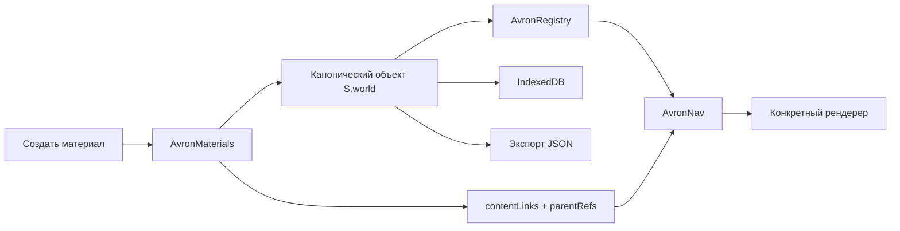

# AVRON ATLAS — полная архитектурная ревизия v38

**Объект аудита:** проект v37, доработанный до v38. **Дата:** 3 ноября 2026. **Методика:** просмотр исходников и всех подключений, аудит импортируемого JSON, проверка ссылок по ID и заголовкам, `node --check` JavaScript и изолированные UI-тесты Chromium. Полный E2E в Phaser на реальном Windows-компьютере **не выполнен**.

## Краткий вывод

Основной дефект в Атласе связей был связан с отдельным устаревшим маршрутом: `creative-studio.js` пытался открыть статью напрямую через функции энциклопедии и не имел способа связать пересечение со статьёй через общее ядро. В v38 пересечение получает тип `lore`, связь на статью создаётся через реестр, а кнопка открытия использует `AvronNav.open('article:<id>')`. В случае отсутствия статьи редактор предлагает создать её; Просмотр не создаёт скрыто материалы.

Весь проект **не переведён на единую внутреннюю модель с полным разделением слоёв**. v38 вводит общий фасад, индекс и маршруты поверх существующих движков. Их собственные массивы по-прежнему остаются каноническими: это сохраняет совместимость с твоим JSON, но часть старых кнопок создания продолжает изменять массивы непосредственно. Реестр видит эти записи автоматически; будущая реорганизация должна заменить вызовы на один API.

## Что стало единым в v38

1. **Идентификаторы:** `kind:id` для объектов карты (`entity`), статей (`article`), витрин (`showcase`), экспонатов (`exhibit`), книг (`book`), художественных сцен (`chronicle`), приключений (`room`), городских зон (`node`), Пантеона (`god`), хронологических событий (`timelineEvent`), пересечений (`lore`), категорий (`section`), записей разделов (`entry`) и карт (`map`).
2. **Фасад данных:** `window.AvronMaterials` (создание, привязка, снятие связи, поиск по заголовку, аудит и индексация явных wiki-ссылок). Его можно вызывать из любого движка.
3. **Сторонние представления:** исходный объект не копируется. Например `exhibit:legacy-section-pantheon~god~1` — виртуальное представление божества №1 в конкретной витрине, а не второй бог.
4. **Родительские связи:** `article.parentRefs` хранит обратный список, `world.contentLinks[parentRef]` — переход к статье. Книга также хранит `articleIds`, пересечение — `articleId`.
5. **Открытие:** `AvronNav.open(ref)` выбирает нужный renderer. Для Атласа `AvronLoreMatrix.open({recordId})`; для статьи `AvronArticleStudio.open(id)`; для Летописей `AvronWorldStudio.openBook(id)`.
6. **Сохранение:** изменяемый `S.world` сохраняется в IndexedDB; экспорт полного JSON — переносимая резервная копия. Стартовый экран v38 теперь умеет обнаружить IndexedDB и восстановить её через «Продолжить».
7. **Finder:** индексирует больше типов материалов, а не только `article/entity/god`; пункт проверки заголовков запускает проверку и однозначное связывание `[[...]]`.

## Прохождение действия



**Пример:** «Атлас связей» → запись `lore:...` → кнопка «Открыть статью». Если статья указана, откроется единый художественный редактор/просмотр. Если её нет, в режиме Редактор можно создать `article:...` с родителями `lore:...` и существующими `entity:...`; в режиме Просмотр выводится сообщение об отсутствии статьи. `Finder` сможет найти эту статью по заголовку и ID.

## Схема основного JSON

| Коллекция/поле | Назначение | Кол-во в v38 | Каноничность |
|---|---|---:|---|
| `entities` | Объекты карты | 266 | канонические записи |
| `articles` | Единые тексты и статьи | 27 | канонические записи |
| `chronicleBooks` | Книги Летописей | 3 | канонические записи |
| `chronicles` | Художественные сцены | 1 | канонические записи |
| `showcases` | Витрины | 3 | канонические записи |
| `adventureRooms` | Подземелья/сюжетные комнаты | 3 | канонические записи |
| `explorerNodes` | Города/зоны | 6 | канонические записи |
| `pantheon` | Божества | 19 | канонические записи |
| `loreRecords` | Пересечения Атласа | 1 | канонические записи |
| `contentLinkSources` | Источники явных переходов | 42 | источник переходов |

Дополнительно: `types` и `relationTypes` — пользовательские типы и отношения; `timeline` — календари, эпохи, кампании, события; `libraries` и `folders` — хранилище статей; `sections` — разделы и отдельные записи; `interfaceSlots` — пользовательское меню/док; `loreMatrix.categories/nodes/records` — матрица; `loreWorkshop` и `storyForgeTables` — библиотеки вопросов и ингредиентов; `authorWorkspace.drafts` — авторские черновики; `contentLinks` — типизированные переходы.

### Семантика связей

- Ссылка хранится **по ID**, не по тексту названия. Переименование не обязано менять ID.
- Несколько родителей допускаются (`article.parentRefs`). Обратная ссылка хранится один раз в `contentLinks`.
- Виртуальный экспонат имеет собственный ID композиции `(витрина, тип исходника, ID исходника)` — это позволяет связать статью с конкретной экспозицией, не клонируя канонический объект.
- `[[Название]]` — авторская текстовая wiki-ссылка. Поиск выбирает **единственное совпадение**; при совпадениях нескольких сущностей требуется ручной выбор. Обычные упоминания в тексте не превращаются автоматически в канонические связи.
- При снятии родителя из книги обновляются также `book.articleIds`; при снятии связи пересечения чистится его `articleId`, если он указывал на снятую статью.
- Черновики Советника остаются отдельно от статьи до явного переноса.

## Результат Finder/JSON аудита

- Явных wiki-ссылок, добавленных после сопоставления заголовков: **2**.
- Уже существовавших и подтверждённых: **50**.
- Неизвестных названий: **0**.
- Неоднозначных заголовков: **0**.
- Тестовые материалы помечены `testOnly`/`integrationTestV38`, а тестовая статья `draft=true`, чтобы не выдавать её за канон.

## Каталог исходных JavaScript-модулей

Следующий перечень — по фактически существующим исходникам, а не выдуманная целевая схема. Указаны главная ответственность и технический долг.

| Путь | Назначение | Строк |
|---|---|---:|
| `pantheon/cinematic.js` | Художественные сцены Пантеона, воспроизведение и переходы между главами. | 121 |
| `pantheon/editor.js` | Редактор Летописей Пантеона, сцены, визуальные главы и создание новой сцены. | 174 |
| `pantheon/library.js` | Библиотека Пантеона и карточки записей. | 24 |
| `pantheon/pantheon.js` | Система Пантеона: боги, их карточки, выбор и исходный зал. | 104 |
| `src/adventure-rooms-v27.js` | Панорамы комнат и подземелий, сюжетные приключения и редакторы комнат. | 25 |
| `src/aether-interface-v3.js` | Оформление ранней общей оболочки и управляющие UI-элементы. | 26 |
| `src/avron-chronicle-v18.js` | Летописи с анимацией, глава/сцены и художественное воспроизведение. | 33 |
| `src/avron-console-v26.js` | Управление материалами и действиями, отчёты, удаление и экспорт в старом консольном UI. | 34 |
| `src/avron-director-v14.js` | Устаревающий отдельный режиссёр; потенциальный дублирующий UI, требует последующего удаления. | 65 |
| `src/avron-halls-manager-v25.js` | Управление формами залов Пантеона и переключениями между ними. | 11 |
| `src/avron-hub-v6.js` | Системный главный зал, диспетчер экранов и маршруты меню. | 30 |
| `src/avron-idea-engine-v34.js` | Сюжетные конструкции, операции комбинаторной генерации. | 183 |
| `src/avron-idea-engine-v35.js` | Большой банк оригинальных сюжетных ингредиентов и таблиц. | 781 |
| `src/avron-popup-v15.js` | Статья-pop-up и сцена-pop-up, мост к объектам. | 15 |
| `src/avron-slots-v8.js` | Редактируемые верхние слоты и нижний док, сборка меню из JSON. | 51 |
| `src/chronicle-links.js` | Вычисляет ссылки сцены на событие Хронологии, календарь, дату и маршрут. | 25 |
| `src/city-explorer-v29.js` | Иллюстрированные города и зоны; интерактивные точки, маршруты, переходы и редактирование. | 67 |
| `src/creative-studio.js` | Атлас связей, визуальный выбор участников и редактирование пересечений. | 130 |
| `src/default-world-current.js` | Единственная актуальная встроенная JSON-копия Аврона v38, загружаемая при выборе «Аврон». | 1 |
| `src/frame-engine.js` | Кадрирование карт и артов, анимированная камера/обрезка. | 60 |
| `src/lore-store.js` | Общее хранилище пересечений loreMatrix, категории, узлы, legacy beliefMatrix и сохранение. | 56 |
| `src/lore-workshop-v36.js` | Анкеты народов/планов/сцен, вопросы, тропы, авторские черновики. | 164 |
| `src/main.js` | Точка запуска: восстановление IndexedDB, useWorld, wireStatic, рендер оболочки, Phaser.Game. | 20 |
| `src/map-widgets.js` | Вспомогательные виджеты карты, компоновка и контролы. | 71 |
| `src/material-registry-v37.js` | Адаптер на канонические массивы мира; поисковый каталог и виртуальные экспонаты; родительские связи статей и черновики. | 42 |
| `src/model.js` | Схема мира, миграция/sanitize, демо-мир и восстановление legacy JSON. Источник глобального состояния S. | 263 |
| `src/navigation-core-v30.js` | Типизированные маршруты kind:id, поиск материалов, открытие движков, ручные переходы, проверка ID. | 109 |
| `src/offline-v31.js` | Стартовый экран Аврон/Новый мир/Продолжить, единая история назад/вперёд и скрытие устаревших экранов. | 80 |
| `src/registry-persistence-v37.js` | IndexedDB (avron-world-v37 / data/current). Последовательная очередь снимков и ошибки сохранения. | 9 |
| `src/relicary-v32.js` | Предметы, коллекция/прогресс исследователя, загадки, открытия статей. | 72 |
| `src/scene-bridge-v20.js` | Интеграция сцен Летописей с объектами карты и всплывающими окнами. | 31 |
| `src/scene.js` | Основной движок Phaser: слои карты, камера, области, маркеры, редактирование и события выбора. | 371 |
| `src/showcase-builder.js` | Конструктор витрин: источник экспонатов, формат, сцена, оформление, кнопки создания/ссылок. | 92 |
| `src/timeline.js` | Обслуживающий модуль интерфейса/интеграции; необходима дальнейшая декомпозиция и контроль зависимостей. | 479 |
| `src/ui.js` | Старая оболочка интерфейса: карты, правый бар, библиотека, Markdown, Finder, кнопки экспорта/импорта. | 995 |
| `src/unified-atelier-v13.js` | Единый редактор Markdown-статей с предпросмотром; создание статьи объекта через реестр. | 23 |
| `src/unified-halls-v22.js` | Совместимость старых залов и витринных режимов. | 11 |
| `src/unified-material-core-v38.js` | Новый общий API AvronMaterials: create, attach, detach, titleLookup, scanWiki, indexExplicitWiki, audit; без дублирования объектов. | 108 |
| `src/world-studio-v11.js` | Мастерская разделов и книжных Летописей chronicleBooks; связь с художественными сценами. | 45 |
| `src/writer-advisor-v33.js` | Советник писателя, контекстный поиск и панель идей, отдельный AI-шлюз. | 190 |

## Слоистая целевая архитектура

```
Avron App / shell (позднее React, пока vanilla JS)
├─ Domain: Materials (типы, IDs, отношения, правила)
├─ Registry: AvronMaterials + AvronRegistry (единый API CRUD)
├─ Persistence: IndexedDB + JSON export/import + migrators
├─ Navigation: AvronNav + AvronHistory + Finder
├─ Presentations: Map/Phaser, Articles, Showcases, Pantheon, Books,
│                Chronicle scenes, Adventure Rooms, City Explorer, Relicary
├─ Authoring: Lore Workshop, Advisor, Story Forge, editor UI
└─ QA: schema validation, reference audit, migration regression,
       button-to-handler integration, offline Windows E2E
```

### Границы ответственности

**Domain:** только данные и правила; никаких DOM или Phaser. **Registry:** единые `create/update/delete/link/unlink`, проверка ID, обратные ссылки, события изменений. **Renderer:** только открытие/отображение существующих данных; не создаёт сущности по факту перехода. **Finder:** индекс, поиск, выбор результата; не создаёт без действия пользователя. **Writer Advisor:** выдаёт идеи, черновик, подтверждение; не пишет канон самостоятельно. **Persistence:** подтверждаемая запись и миграция форматов, а не оптимистичный текст «сохранено». 

## Аудит кнопок создания

| Место | v38 | Технический статус |
|---|---|---|
| Хранилище статей: `＋ Статья` | Родители и запись через `AvronRegistry.create` | Проверено на уровне DOM/API |
| Атлас связей: `＋ Создать статью` | Через `AvronMaterials.create`; пересечение и участники — родители | Проверено в Chromium |
| Атлас связей: `Открыть статью` | Через `AvronNav`; если не назначено — предложение создать в Редакторе | Проверено в Chromium для назначенной статьи |
| Летопись: `＋ Создать статью` | Через `AvronMaterials.create` + связь с книгой | Проверено через API; полный редактор не тестирован |
| Летопись: `＋ Привязать статью` | Добавляет `book.articleIds` и общий переход | Проверено на уровне API |
| Витрина: `▤ Статья` | Создаёт через фасад, привязывает к экспонату, исходнику, витрине | Синтаксис и виртуальные refs проверены; полный E2E витрины остаётся |
| Finder: поиск | Сканирует статьи, объекты, Пантеон, витрины, экспонаты, книги, события, пересечения | Проверено в Chromium |
| Finder: `＋ Создать статью` | Использует реестр, сохраняет прежний режим поиска по названию | Частично проверено |
| Объект: `Статья` | Через `AvronMaterials.create`; `entity.articleId` сохраняется | Программная проверка; Phaser-клик не E2E |
| Старые кнопки конструкторов бога, комнаты, сцены, карты, секции | Данные по-прежнему в `S.world` и индексируются динамически | Не все вызовы перенесены на единый `create`, полная ревизия интерфейса продолжается |

## Известные риски и ограничения

**P0 — перед релизом на Windows:** полная проверка загрузки JSON, восстановления IndexedDB и экспорта после редактирования; объём большого встроенного изображения может превышать ограничения разных браузерных профилей. Проверить на чистом профиле и на профиле с v37. Стартовый экран теперь смотрит IndexedDB, но перенос нескольких сохранённых миров в единую библиотеку ещё отсутствует.

**P1 — маршрутизация:** часть старых экранов открывается непосредственно через собственный модуль; глобальный Back и скрытие остальных overlay улучшены, но все варианты Phaser/cinematic/viewer не проверены в живом приложении. Особенно важно проверить цепочки `город → объект → витрина → статья → назад` и `пантеон → бог → пересечение → статья`.

**P1 — атомарность обновления ссылок:** `contentLinks`, `article.parentRefs`, `book.articleIds`, `loreMatrix.records.articleId` одновременно обслуживаются несколькими редакторами. v38 синхронизирует новые пути, но legacy-удаление и массовое переименование ещё не подчинены одному централизованному транзакционному сервису. Запланировать `deleteMaterial` с очисткой всех ссылок и тесты миграции.

**P1 — классификация документов:** `sections.entries` и `chronicles` пока отдельные сущности от `articles` и `chronicleBooks`; общий реестр типизирует их, но не все старые представления полноценно открываются в едином API. Не следует заявлять полную унификацию данных до миграции.

**P2 — производительность:** Finder сейчас индексирует мир на стороне клиента; крупные миры с тысячами экспонатов требуют инкрементального индекса, виртуализации результатов и фоновой проверки. Браузерное окно не должно рендерить сотни карточек одновременно.

**P2 — очистка legacy:** устаревающие `avron-director-v14`, ранние обвязки залов и CSS-пакеты всё ещё существуют. `src/default-world-current.js` теперь одна встроенная копия мира; старые `default-world-v30/v31` из текущей сборки убраны. Для React-переезда сначала покрыть контрактами текущие JSON/refs.

**Безопасность:** картинки и Markdown могут включать внешние ссылки. Технический аудит не доказывает защиту от XSS или вредоносного JSON; перед публичным размещением нужен отдельный security review HTML-санации, загрузок, ссылок и AI-шлюза.

## План следующего технического этапа

1. Подготовить JSON Schema + версионные миграции для каждой предметной коллекции; запретить неверные ID и типы на уровне сервиса.
2. Перевести **все** кнопки создания/удаления старых движков на `AvronMaterials` и убрать прямые `.push`, сохраняя представления для совместимости.
3. Централизовать `open/close`, `Back/Forward` и состояние камеры/выбранного объекта; сквозные Playwright E2E с реальным Phaser.
4. Протестировать действительную долговечность IndexedDB и экспорт JSON в обычном браузере/Windows оболочке на чистом профиле и после импорта v37.
5. Удалить старые редакторы-дубли, оставить общие компоненты формы, типы и сам движок презентаций; только затем рассматривать перенос оболочки в React.

## Повторяемость

- `python tests/test_registry_v38.py` — реестр/маршрут матрицы/статья/мульти-родители/удаление привязки.
- `python tests/test_finder_v38.py` — поиск по названиям и привязка к экспонату.
- `for f in src/*.js pantheon/*.js; do node --check "$f" || exit 1; done` — синтаксическая проверка каждого файла.
- `FINDER_LINK_AUDIT_V38.json` — точные результаты сопоставления `[[...]]` по ID и заголовкам.
- `QA_REPORT_V38.md` — таблица проверенных сценариев и ограничений.

**Завершено:** архитектурная инвентаризация, новое ядро и исправление ключевого маршрута Атласа. **Не завершено:** полный перенос каждого старого конструктора на API и интеграционные проверки всех физических экранов в полном приложении. Это отмечено открыто, чтобы следующий этап багфикса имел честную базовую точку.
